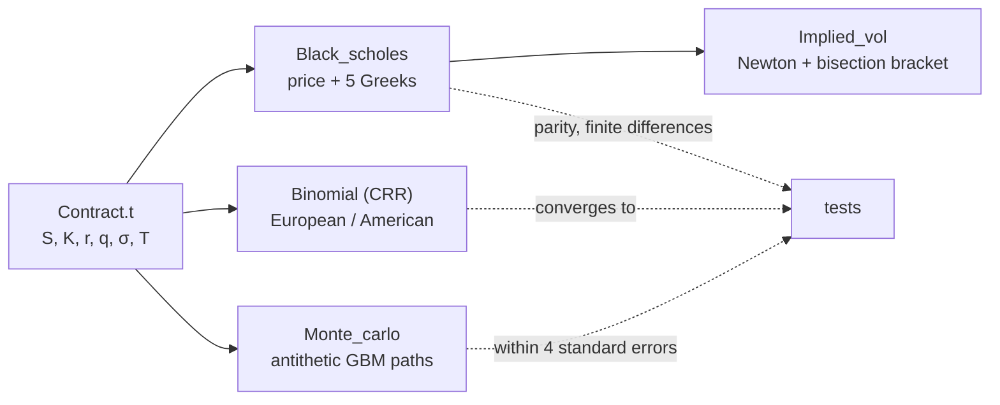

# ocaml-option-pricer

European and American option pricing in OCaml with no dependencies beyond the standard library.
It has four independent methods (closed form, binomial tree, Monte Carlo and implied-volatility
inversion), and the tests check every one against the others.

```
$ dune exec bin/main.exe -- --strike 110 --put
European put  S=100 K=110 r=0.05 q=0 vol=0.2 T=1

  Black-Scholes           10.675325
  CRR tree (1000 steps)   10.676849
  Monte Carlo             10.678370  +/- 0.013676
  American (CRR)          11.973757  (early-exercise premium 1.296909)

  delta  -0.55035   gamma   0.01979   vega  39.57605   theta  -0.67208   rho -65.71053

  implied vol of the BS price: 0.200000000000
```

## What's inside



**Black–Scholes–Merton** with continuous dividend yield q:

$$C = Se^{-qT}N(d_1) - Ke^{-rT}N(d_2),\qquad d_{1,2} = \frac{\ln(S/K) + (r - q \pm \tfrac12\sigma^2)T}{\sigma\sqrt T}$$

$N$ uses `Float.erfc`, which stays accurate deep in the tails (no `1 − tiny` cancellation). The
module also returns analytic delta, gamma, vega, theta and rho.

**Cox–Ross–Rubinstein tree.** Each step moves up by $u = e^{\sigma\sqrt{\Delta t}}$ or down by $d = 1/u$,
with risk-neutral probability $p = (e^{(r-q)\Delta t} - d)/(u - d)$. American exercise takes
`max(continue, exercise now)` at every node.

**Implied volatility.** Newton's method converges quadratically but breaks down where vega is tiny.
So the solver keeps a bracket that always contains the root (price is increasing in σ) and bisects
whenever a Newton step would leave it. It stops when *σ* has converged, not the price. For a far
out-of-the-money option the price can be 10⁻⁹ while vega is 10⁻⁶, so a price tolerance would stop
at the wrong σ.

**Monte Carlo.** Exact GBM terminal sampling with antithetic pairs (+Z, −Z), returning the price
and its standard error.

## Tests

| test | what it checks |
|---|---|
| reference value | S = K = 100, r = 5 %, σ = 20 %, T = 1 gives a call of 10.4506 |
| put–call parity | $C - P = Se^{-qT} - Ke^{-rT}$ to 1e-12 across 20 strike/maturity pairs |
| Greeks | all five analytic Greeks, calls and puts, match central finite differences |
| tree convergence | CRR error shrinks with steps and is below 2e-3 at 2,000 steps |
| no early exercise | an American call on a non-dividend stock equals the European call |
| early-exercise premium | an in-the-money American put is worth more than the European |
| implied vol | 46 identifiable (strike, σ, call/put) cases round-trip to 1e-8; prices outside no-arbitrage bounds are rejected |
| Monte Carlo | within 4 standard errors of the closed form |

**Implied vol isn't always recoverable.** At σ = 5 %, a call struck at 70 is worth its intrinsic
value to about 10⁻²⁰. There is no time value left in double precision to invert, so the test
documents this and skips those cases instead of pretending otherwise.

## Why OCaml

- `type kind = Call | Put` with exhaustive pattern matching means a forgotten case won't compile.
- Immutable records make bumping inputs safe and explicit: `{ o with vol = o.vol +. h }` builds every
  finite-difference Greek in the tests.
- `result` types (`Ok v | Error msg`) make the implied-vol failure modes part of the signature.

## Build

```bash
opam install dune     # or: apt install ocaml-dune
dune build
dune test
dune exec bin/main.exe -- --spot 100 --strike 95 --vol 0.3 --expiry 0.5 --dividend 0.02
```

CI runs on OCaml 4.14 and 5.2.

## License

MIT
